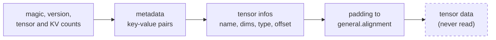

# gguf-inspect

[](https://github.com/aozmekik/gguf-inspect/actions/workflows/ci.yml)
[](LICENSE)

Inspect GGUF model files (the llama.cpp / ggml format) without loading tensor
data: metadata, tensors, quantization mix, KV-cache size, and header diffs.

Status: early, v0.1.0. The library API and the JSON output may change.

## Why

A GGUF model is a multi-gigabyte file whose useful facts (architecture,
context length, quantization, vocabulary, tensor shapes) sit in a header of a
few megabytes. Questions like "how many parameters is this?", "which
quantization types does it actually use?", "how much memory will an 8k
context need?" or "what changed between these two conversions?" should not
require loading the model or installing a Python stack. `gguf-inspect` reads
only the header, treats the file as untrusted input, and answers with aligned
tables or JSON.

## Features

- **Format coverage**: GGUF versions 2 and 3, little-endian. Big-endian files
  are detected from the byte-swapped version field and rejected with a clear
  error. All 13 metadata value types, including nested arrays; tensor infos
  (name, shape, ggml type, offset); `general.alignment`; the data section offset.
- **Header only**: a 256 KiB buffered reader stops at the end of the tensor
  infos. On a 4.82 GiB synthetic model, `gguf-inspect info` takes about 9 ms
  and peaks at 9.3 MB resident memory ([benchmarks](#benchmarks)).
- **Untrusted input**: every declared length and count is checked against
  configurable `Limits` and against the bytes left in the file before
  anything is allocated. Malformed input produces an error with the byte
  offset of the offending field and the entry being read; the crate contains
  no `unsafe` code. Keys, names and values from the file are escaped before
  they reach the terminal, so a crafted file cannot send escape sequences or
  forge output lines.
- **Checked against llama.cpp's own writer**: besides its own synthetic
  files, the test suite reads files written by gguf-py, the library llama.cpp
  uses to write models, and checks every value, shape and offset.
- **Useful on damaged files**: problems that do not stop the header from being
  read (truncated downloads, misaligned or overlapping tensor data, missing
  required keys) are reported as warnings rather than failures.
- **KV-cache estimates that follow llama.cpp**: grouped-query attention,
  per-layer KV heads, multi-head latent attention (K-only cache) and
  recurrent models, with the formula and the file's values shown.
- **ggml type table** for 35 tensor types (block size, block bytes, bits per
  weight); CI compares every type ID, name and size with ggml's own table.
- **CLI**: `info`, `metadata`, `tensors`, `kv-cache`, `diff`, `types`; `--json`
  on every command.
- **Library** with zero dependencies (the CLI's dependencies sit behind the
  default `cli` feature).

## Install

Not yet published to crates.io. Minimum supported Rust version: 1.88
(declared in `Cargo.toml` and checked by the CI `msrv` job; the test suite
was run locally with Rust 1.99.1 and 1.91.1).

```sh
cargo install --locked --git https://github.com/aozmekik/gguf-inspect --tag v0.1.0 gguf-inspect
```

The trailing package name is needed because the repository also contains the
fuzzing crate, which has binaries of its own.

As a library, without the CLI dependencies:

```toml
[dependencies]
gguf-inspect = { git = "https://github.com/aozmekik/gguf-inspect", default-features = false }
```

## Quick start

No model at hand? The repository can write synthetic ones (generated
vocabulary, zero or sparse tensor data):

```sh
git clone https://github.com/aozmekik/gguf-inspect && cd gguf-inspect
cargo run --example synth -- tiny.gguf                 # 1 MiB, fully written
cargo run --example synth -- --llama3-8b llama3.gguf   # 4.82 GiB apparent size, sparse
```

All output below is from that synthetic 8B-shaped file, not a real model.

```text
$ gguf-inspect info llama3.gguf
file      llama3.gguf
size      4.82 GiB (5,175,662,304 bytes)
format    GGUF v3, alignment 32, data offset 3,241,696
metadata  19 entries
tensors   291

architecture    llama
name            Synthetic Llama-3-8B-shaped
parameters      8.03 B (8,030,261,248)
file type       MOSTLY_Q4_K_M (15)
context length  8,192
embedding       4,096
layers          32
feed forward    14,336
heads           32
kv heads        8 (grouped-query attention, 4 heads per KV head)
rope            dimensions 128, freq base 500000
tokenizer       gpt2, vocabulary 128,256

quantization
  TYPE  TENSORS  PARAMETERS     BYTES  SHARE    BPW
  q4_K      161      5.49 B  2.88 GiB  59.7%   4.50
  q6_K       65      2.54 B  1.94 GiB  40.3%   6.56
  f32        65    266.24 K  1.02 MiB   0.0%  32.00
```

The parameter count is computed from tensor shapes, not read from metadata.

```text
$ gguf-inspect kv-cache llama3.gguf --ctx 8192 --cache-type q8_0
KV cache estimate for llama3.gguf (llama)

  block_count    32
  head_count     32
  head_count_kv  8      grouped-query attention, 4 heads per KV head
  key_length     128    embedding_length 4096 / head_count 32
  value_length   128    embedding_length 4096 / head_count 32
  cache type     q8_0   34 bytes per 32 elements
  context        8,192  tokens per sequence
  sequences      1

formula
  K per layer and token = row_size(q8_0, 8 x 128 = 1,024) = 1,088 B
  V per layer and token = row_size(q8_0, 8 x 128 = 1,024) = 1,088 B
  total = sequences x ctx x block_count x (K + V)
        = 1 x 8,192 x 32 x 2,176 B
        = 570,425,344 B (544.00 MiB)
```

```text
$ gguf-inspect metadata llama3.gguf --filter tokenizer.
KEY                          TYPE           VALUE
tokenizer.ggml.model         string         "gpt2"
tokenizer.ggml.tokens        array[string]  ["tok_0", "tok_1", "tok_2", "tok_3", "tok_4", "tok_5", "tok_6", "tok_7", ... 128,248 more] (128,256 items)
tokenizer.ggml.scores        array[f32]     [0.0, -1.0, -2.0, -3.0, -4.0, -5.0, -6.0, -7.0, ... 128,248 more] (128,256 items)
tokenizer.ggml.token_type    array[i32]     [3, 3, 3, 1, 1, 1, 1, 1, ... 128,248 more] (128,256 items)
tokenizer.ggml.bos_token_id  u32            0
tokenizer.ggml.eos_token_id  u32            1

long arrays and strings are truncated; use --full to show them
```

## Usage

| Command | Shows |
|---|---|
| `info <file>` | Architecture, name, parameter count, file size, quantization breakdown (tensors, parameters, bytes, share, bits per weight per ggml type), context length, embedding size, layers, heads and KV heads, head sizes, experts, RoPE, tokenizer, and warnings from validation. |
| `metadata <file> [--filter <prefix>] [--full]` | Every key with its type and value, in file order. Arrays longer than 8 elements and strings longer than 64 characters are cut unless `--full` is given. Strings are quoted, with control and invisible characters escaped. |
| `tensors <file> [--sort file\|size\|name\|offset]` | Name, type, shape (ggml order, innermost first), elements, bytes, absolute offset. |
| `kv-cache <file> --ctx <n> [--cache-type <t>] [--sequences <n>]` | KV-cache size for `--ctx` tokens in each of `--sequences` sequences, with the formula and the file's values substituted. Cache types: `f32`, `f16` (default), `bf16`, `q8_0`, `q5_1`, `q5_0`, `q4_1`, `q4_0`, `iq4_nl`. |
| `diff <a> <b>` | Version, alignment, added/removed/changed metadata (for arrays, the first differing index) and tensors whose type or shape changed. |
| `types` | The ggml types this build knows, with block size and block bytes, and the IDs ggml has removed. |

`kv-cache` sizes the cache the way llama.cpp allocates it
([ADR 0004](docs/adr/0004-kv-cache-estimates-follow-llama-cpp.md)). In
llama.cpp, `-c` is the total for all `-np` sequences, so `-c 8192 -np 4`
corresponds to `--ctx 2048 --sequences 4` (`--parallel` is an alias for
`--sequences`); `-b`/`--batch-size` does not change the KV cache. llama.cpp
also rounds the context up to a multiple of 256.

Every command accepts `--json`; the output is described in
[docs/json.md](docs/json.md). Arrays in JSON are cut to their first 8
elements at every level, with `len` and `"truncated": true` saying so,
unless `metadata --full` is given; strings are never cut. Exit status is 0
on success, 1 when `diff` finds differences (like `diff(1)`), and 2 on
errors. A closed output pipe (`| head`) is not an error.

```sh
gguf-inspect metadata model.gguf --json | jq -r '.[] | select(.key == "general.name") | .value'
gguf-inspect tensors model.gguf --json --sort size | jq '.[0]'
gguf-inspect diff old.gguf new.gguf >/dev/null || echo "headers differ"
```

### Library

```rust,no_run
use gguf_inspect::kv_cache::{KvCacheConfig, estimate};
use gguf_inspect::{GgmlType, GgufFile, ModelInfo};

fn main() -> Result<(), Box<dyn std::error::Error>> {
    let gguf = GgufFile::open("model.gguf")?;
    let info = ModelInfo::from_file(&gguf);
    let arch = info.architecture.as_deref().unwrap_or("unknown architecture");
    println!("{arch} with {} parameters", gguf.parameter_count());

    for stats in gguf.type_breakdown() {
        println!("{}: {} tensors, {} bytes", stats.ggml_type, stats.tensors, stats.bytes);
    }
    let kv = estimate(&gguf, &KvCacheConfig::new(8192).with_cache_type(GgmlType::Q8_0))?;
    println!("KV cache: {} bytes", kv.total_bytes);

    for issue in gguf.validate() {
        eprintln!("warning: {issue}");
    }
    Ok(())
}
```

`GgufFile::from_bytes` parses a slice and `GgufFile::from_reader` any `Read`
of known length; `Limits` tightens or loosens the allocation caps. The
[`examples/`](examples) directory has a runnable version
(`cargo run --example summary`). API docs: `cargo doc --open`.

## Design



- **Bounded streaming reader, not mmap**
  ([ADR 0001](docs/adr/0001-bounded-streaming-reader-instead-of-mmap.md)).
  Mapping a file is `unsafe` in Rust and a concurrent truncation is undefined
  behaviour; only the header is needed, so a buffered reader costs little and
  keeps the crate free of `unsafe`. Declared counts are checked against
  `remaining bytes / smallest possible element size` (1 byte for a `u8`, 8 for
  a string's length prefix, 12 for a nested array), and vectors of
  variable-size elements reserve at most 65,536 slots before growing as
  elements are parsed, so capacity is never taken from the file on trust.
- **Errors for the header, issues for the data section**
  ([ADR 0002](docs/adr/0002-header-errors-versus-data-section-issues.md)).
  Anything that makes the header unreadable or ambiguous is an error with a
  byte offset; misplaced or missing tensor data is a warning, so partial
  downloads can still be inspected. The ADR lists where this is stricter or
  more lenient than ggml's `gguf.cpp`.
- **Dependency-free library, CLI behind a default feature**
  ([ADR 0003](docs/adr/0003-dependency-free-library-with-optional-cli.md)).
- **KV-cache estimates follow llama.cpp**
  ([ADR 0004](docs/adr/0004-kv-cache-estimates-follow-llama-cpp.md)), at a
  pinned commit, and refuse keys that are present but unusable rather than
  falling back to defaults.
- **Terminal-safe output.** Every file-derived string in text output passes
  through one escaper (C0/C1 controls, DEL, bidi overrides, zero-width and tag
  characters become `\u{..}`); JSON output escapes the same characters, so
  parsed values stay exact.
- **Compact storage.** Metadata arrays are typed vectors (`Vec<String>`,
  `Vec<f32>`, ...), keys and tensor names are stored once and found by binary
  search, and `metadata` and `tensors` print in two passes without keeping
  rendered rows. `Limits` documents the worst-case memory per entry.
- **Exact comparisons.** `diff` compares floats by bit pattern, so `NaN`
  equals itself and `0.0` differs from `-0.0`.

## Testing

152 tests pass with `cargo test --workspace` (Rust 1.99.1, Apple M1 Pro), and
one opt-in test is ignored by default:

- A test-only writer ([`testkit/`](testkit), not published) generates synthetic
  files: every metadata type, versions 2 and 3, alignments from 1 to 4096,
  big-endian byte order, and deliberately broken records.
- Files written by gguf-py 0.19.0, llama.cpp's reference writer
  ([`tests/fixtures/gguf-py/`](tests/fixtures/gguf-py/README.md)): every value
  type, nested arrays, five tensor types, alignment 32 and 64, and a
  big-endian variant. The test reads the tensor bytes at the offsets the
  parser computes. CI regenerates the files and checks they are identical.
- Property tests (proptest) write random metadata, nested arrays and tensors,
  parse them back and compare (256 cases per run), and overwrite random header
  bytes or append random bodies to check that parsing never panics (512 cases
  each).
- Property tests of the binary (`tests/cli_properties.rs`): every subcommand
  on mutated headers and on files whose keys, values and names are arbitrary
  Unicode must exit with 0, 1 or 2, never panic, print no control or
  invisible characters, and emit valid JSON (48 cases each in CI; a one-off
  run of 2,000 cases each passed).
- Malformed input: truncation at every byte offset of a header, bad magic,
  big-endian files, versions 0, 1 and 4, absurd counts and lengths, invalid
  type tags, bools and UTF-8, duplicate keys and tensor names, bad alignments,
  unknown and removed ggml types, overflowing shapes, 100,000 levels of nested
  arrays with the depth limit raised to `u32::MAX` on a 1 MiB stack. Tests
  assert the error kind and its byte offset.
- Peak heap, measured with dhat's counting allocator (`tests/memory.rs`): a
  12 MiB file declaring seven levels of million-element nested arrays peaks
  below 16 MiB, and parsing the 3.24 MB header of the 8B-shaped synthetic
  model peaks at 5.4 MB.
- CLI snapshot tests (insta) of every subcommand, text and JSON, including a
  file whose strings carry escape sequences, a forged row and a bidi override.
- Fuzzing: a [cargo-fuzz target](fuzz/README.md), scheduled to run weekly in
  CI on nightly with AddressSanitizer. Locally it ran for 300 s on stable Rust without a
  sanitizer (no nightly toolchain was available), with overflow checks on:
  24,324,815 executions, no crashes, peak RSS 35.2 MB.
- Line coverage 97.5% (region coverage 95.7%) of `src/`, measured with
  `LLVM_BIN=/opt/homebrew/opt/llvm/bin scripts/coverage.sh` (LLVM 23.1.3
  source-based coverage; tests, testkit, examples and benches are excluded
  from the denominator, doctests are not counted).
- Real models: `tests/real_models.rs` runs every command on files named in
  `GGUF_INSPECT_REAL_MODELS` (see [CONTRIBUTING.md](CONTRIBUTING.md)). No real
  model was available during development, so it has not been run on one yet.

The ggml type table is checked against ggml with
[`scripts/check-ggml-type-table.sh`](scripts/check-ggml-type-table.sh), which
compiles ggml's own `type_traits` table against its headers at the pinned
commit and compares every type ID, name, block size, block byte size,
quantized flag and removed ID with `gguf-inspect types` (output on the
development machine: `ok: 35 types and 8 removed IDs match ggml
a05c9922613c6a2230dbb1d0de679519ecafb4f0`).

## Benchmarks

Apple M1 Pro (8 cores), 16 GB RAM, macOS 26, Rust 1.99.1, release build with
thin LTO, synthetic inputs, on a machine shared with other build jobs (load
average about 8). Commands, conditions and more results, including
worst-case memory, are in [docs/benchmarks.md](docs/benchmarks.md).

| `cargo bench --bench parse` (criterion 0.8.2) | Header | Mean [95% CI] | Throughput |
|---|---:|---:|---:|
| 150,000-entry vocabulary, from memory | 3.79 MB | 5.90 ms [5.87, 5.94] | 612 MiB/s |
| 8B Llama-3-shaped header, from memory | 3.24 MB | 4.43 ms [4.25, 4.73] | 698 MiB/s |
| same, `GgufFile::open` (page cache warm) | 3.24 MB | 5.21 ms [5.19, 5.23] | 593 MiB/s |

| `hyperfine --warmup 5 --runs 50 -N` on the 4.82 GiB sparse file | Wall time | Peak RSS (median) |
|---|---:|---:|
| `gguf-inspect info` | 8.7 ms ± 0.5 ms | 9.3 MB |
| `gguf-inspect tensors` | 10.0 ms ± 1.1 ms | 9.5 MB |
| `gguf-inspect metadata --json` | 9.2 ms ± 1.5 ms | 9.3 MB |
| `gguf-inspect kv-cache --ctx 8192` | 8.9 ms ± 1.0 ms | 9.3 MB |
| `gguf-inspect types` (process start-up) | 2.6 ms ± 0.2 ms | 2.1 MB |

MB is 10^6 bytes.

## Limitations

- Not yet run on real model files: correctness rests on the specification,
  ggml's and llama.cpp's sources, and files written by gguf-py.
- Little-endian only. Big-endian files (GGUF v3 allows them) are rejected
  with `ErrorKind::BigEndian`; GGUF v1 is rejected as unsupported.
- Regular files only: pipes, process substitution (`<(...)`) and devices are
  rejected with `ErrorKind::NotARegularFile`, because declared sizes are
  checked against the file size. There is no stdin mode yet.
- Tensor data is never read or checksummed; `validate()` only checks where
  it lies.
- Strings must be valid UTF-8 and bools must be 0 or 1, as the spec says;
  ggml's reader is more lenient on both
  ([ADR 0002](docs/adr/0002-header-errors-versus-data-section-issues.md)).
- Tensor types newer than this crate (or removed from ggml) are rejected,
  because their storage size is unknown.
- The KV-cache estimate follows llama.cpp at commit `547208d` and uses the
  same type for K and V. Sliding-window caches (the estimate is then an upper
  bound), recurrent state, compute buffers, the weights and llama.cpp's
  padding of the context to 256 tokens are not included; the command prints
  a note when a file uses sliding windows, latent attention or recurrent
  layers.
- `general.file_type` names come from the spec (IDs 0-18) and llama.cpp's
  `llama_ftype` (19-41); newer IDs are shown as numbers.
- Split models (`*-00001-of-00003.gguf`) are inspected one shard at a time.
- JSON: non-finite floats become `null`, and nested arrays do not carry the
  element type of inner arrays.

## Roadmap

- Read a header from stdin or a ranged HTTP download (`curl -r 0-16M`).
- Aggregate split models (`split.count`, `split.no`) into one view.
- Optional `serde` feature for the library's public types.
- Separate `--cache-type-k` and `--cache-type-v`, and sliding-window-aware
  estimates.
- Optional tensor data checksums.
- Publish to crates.io once the API settles.

## Contributing

See [CONTRIBUTING.md](CONTRIBUTING.md) for the build, test, lint and fuzz
commands, and [SECURITY.md](SECURITY.md) for reporting crashes on crafted
files. Changes are listed in [CHANGELOG.md](CHANGELOG.md).

## References

- GGUF specification: [`docs/gguf.md`](https://github.com/ggml-org/ggml/blob/a05c9922613c6a2230dbb1d0de679519ecafb4f0/docs/gguf.md)
  in ggml at commit `a05c992` (2026-10-15); the file was last changed in
  commit `6af560d` (2026-07-09).
- ggml type IDs, names and storage sizes: `enum ggml_type` in `include/ggml.h`,
  the `type_traits` table in `src/ggml.c` and the block structs in
  `src/ggml-common.h`, same commit.
- Reader behaviour compared against ggml's `src/gguf.cpp` (same commit) and the
  big-endian layout against llama.cpp's `gguf-py/gguf/gguf_writer.py`.
- KV-cache sizing and `general.file_type` names: llama.cpp at commit
  [`547208d`](https://github.com/ggml-org/llama.cpp/tree/547208dca250ceb3e4c8615598d043f2b602a527)
  (2026-10-18): `src/llama-kv-cache.cpp`, `src/llama-hparams.cpp`,
  `src/llama-model.cpp`, `src/models/deepseek2.cpp`, `src/llama-context.cpp`
  and `include/llama.h`.
- No code was copied from ggml or llama.cpp; gguf-py is used only to write
  test fixtures.
- Tools: [proptest](https://github.com/proptest-rs/proptest),
  [insta](https://insta.rs), [dhat](https://github.com/nnethercote/dhat-rs),
  [criterion](https://github.com/bheisler/criterion.rs),
  [cargo-fuzz](https://github.com/rust-fuzz/cargo-fuzz) / libFuzzer,
  [hyperfine](https://github.com/sharkdp/hyperfine),
  [gguf-py](https://github.com/ggml-org/llama.cpp/tree/master/gguf-py).

## License

[MIT](LICENSE)

Built by [Ahmed Semih Özmekik](https://github.com/aozmekik) at [Fergani](https://fergani.tr).
